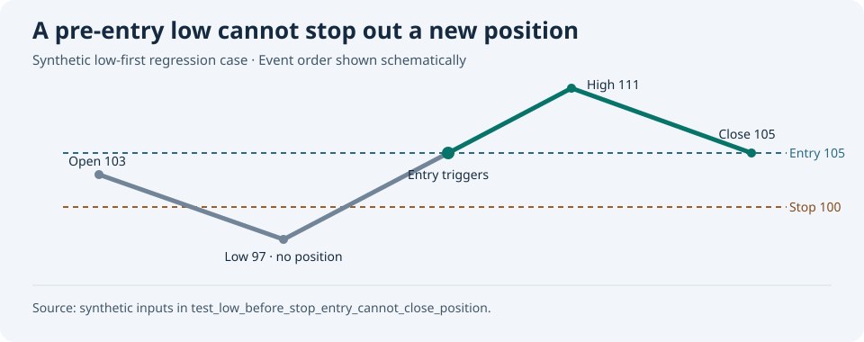
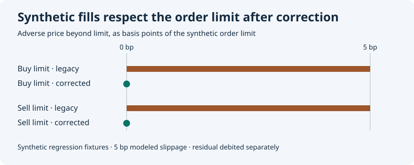

# Backtest Reliability: Execution Modeling, Transaction Costs and Reproducibility

## Research question

How sensitive is the evaluation of a U.S. equity or ETF strategy to when the execution engine allows a trade and how it charges costs? The original private audit reconciled **40 archived scenarios** across four strategy variants, two previously reviewed windows and five execution and cost settings. The corrected validation froze the strategy inputs and compared **24 pairs in two short windows**.

## Execution findings

- The legacy full-bar logic could trigger a stop or target using a price reached before entry. The corrected model checks the remaining route from the entry touch. The original v5.4.1 HL and LH branches already included post-entry path logic and were used as separate comparators.
- The original slippage treatment could place a buy above its limit or a target sale below its limit. The correction caps or floors the modeled fill and books residual adverse slippage separately. Explicit fees apply to fill notional.
- The modeled routes are open–high–low–close and open–low–high–close. Where their outcomes disagree, the local conservative rule prefers a stop over holding and holding over a target. These scenarios cannot establish the actual route or a bound on portfolio returns.

The figure uses the synthetic regression inputs O=103, H=111, L=97, C=105, entry=105 and stop=100. In this route the early stop touch has no effect on the position. The [four regression assertions](../../tests/test_regressions.py) also cover pre-entry targets and both limit bounds. All four failed in the legacy run and passed after correction. The full synthetic suite passed 21 tests.

## Evidence and limits

A private frozen-input run reproduced 24 paired comparisons. The known execution counterexample was used to probe event ordering, and a separate short window was anchored to the original study’s start for baseline reconciliation. The historical v5.3 comparison failed for 2018–2023, and metadata could not identify the exact original run revision. Survivorship bias, independent out-of-sample testing, actual fill probability and corrected full-period results remain unresolved.

[Validation evidence](../../results/validation_evidence.csv) · [Reproducibility](../../docs/REPRODUCIBILITY.md) · [Limitations](../../docs/RESEARCH_LIMITATIONS.md)

## Quantitative synthetic comparison

The same four synthetic fixtures were run through the archived legacy functions and the corrected execution module. The figures are event counts and modeled fill prices on synthetic bars.

| Fixture | Legacy | Corrected |
|---|---:|---:|
| Stop touched before entry | 1 exit | 0 exits |
| Target touched before entry | 1 exit | 0 exits |
| Buy limit at 100 | fill at 100.05 | fill at 100 |
| Sell limit at 109 | fill at 108.9455 | fill at 109 |

Both legacy limit violations are 5 bp relative to the respective limit. The corrected fills respect both bounds and carry the remaining simulated slippage as a separate cost of 0.05 and 0.0545 synthetic price units per unit traded. This isolates execution logic without measuring a strategy return.

[Comparison CSV](../../results/synthetic_execution_comparison.csv) · [Market data publication review](../../docs/DATA_PUBLICATION_REVIEW.md)
